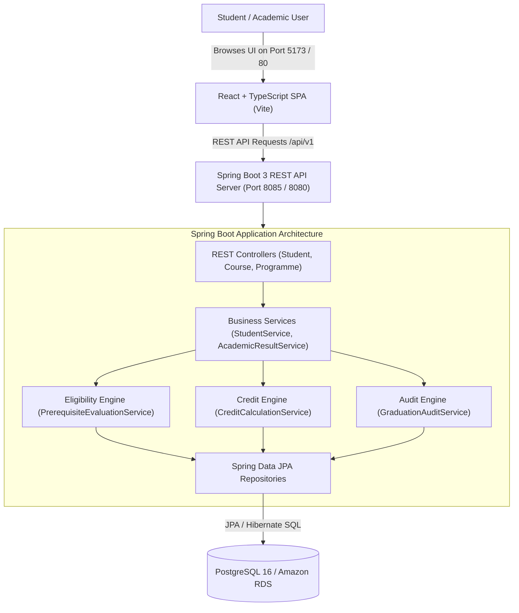
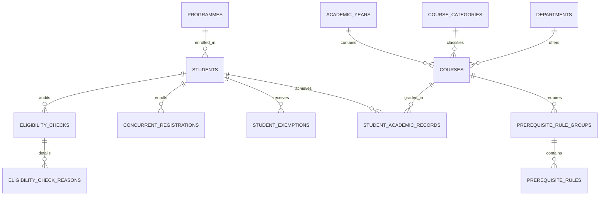
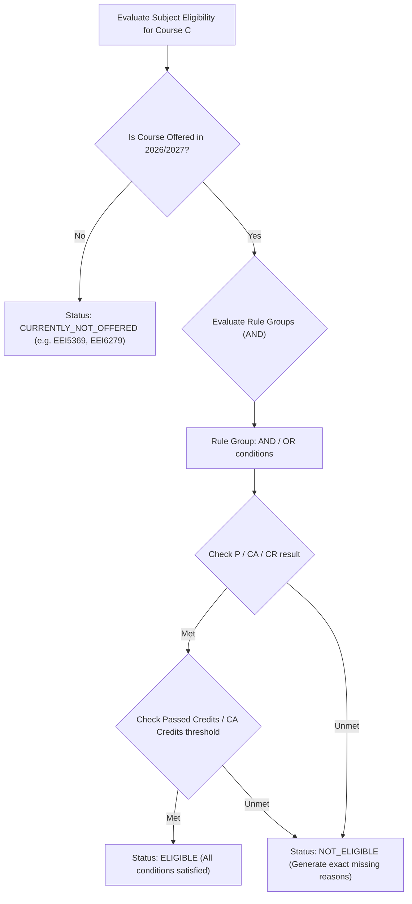

# UniEligible – OUSL Student Subject Eligibility and Academic Progress Calculator

[](https://github.com/ousl-engineering/unieligible/actions)
[](https://www.oracle.com/java/)
[](https://spring.io/projects/spring-boot)
[](https://react.dev/)
[](https://www.typescriptlang.org/)
[](https://www.postgresql.org/)
[](LICENSE)

> **Official Academic Reference:** Open University of Sri Lanka (OUSL) Bachelor of Software Engineering Honours (BSEHons) Student Guidebook 2026/2027.

---

## 1. Project Overview

**UniEligible** is an enterprise-grade full-stack academic planning and eligibility calculation platform tailored specifically for undergraduate students following the **Bachelor of Software Engineering Honours (BSEHons)** programme at the **Open University of Sri Lanka (OUSL)**.

The application allows students to enter their academic examination results year-by-year (**PA** – Passed, **CA** – Continuous Assessment Pass, **FA** – Failed), automatically evaluates eligibility for future subjects in subsequent academic levels, tracks accumulated credits across official course categories, and performs an automated **Graduation Compliance Audit** against the 125-credit degree requirement.

> [!IMPORTANT]
> **Advisory Disclaimer:** UniEligible is an unofficial student planning and advisory tool. Official course registrations, prerequisite waivers, and final degree conferment decisions remain strictly subject to OUSL Senate approval.

---

## 2. Key Features

- **Interactive 4-Year Academic Progression:** Four dedicated, expandable tabs for **Year 1 – Level 3**, **Year 2 – Level 4**, **Year 3 – Level 5**, and **Year 4 – Level 6**.
- **Mutually Exclusive Result System:** Single-choice radio buttons for `PA` (Passed), `CA` (Continuous Assessment Pass), `FA` (Failed), and `Not Attempted` (Clear).
- **Backend-Driven Eligibility Engine:** Spring Boot backend independently computes eligibility using structured rules, evaluating AND/OR conditions, level-specific passed credit thresholds, CA credit thresholds, concurrent registrations, and course availability.
- **Explainable Eligibility Indicators:** Every ineligible subject provides clear, human-readable explanations detailing the exact missing prerequisite subjects, continuous assessment status, or credit deficits.
- **Accurate Credit Accounting:**
  - `MHZ2250` (Elementary Mathematics for Computing) is treated as a Level 2 non-degree credit course (`2*` rating) and excluded from graduation totals.
  - `LTE34SI` (Intermediate English) is recognized as a non-GPA exception whose credits contribute to official Category totals.
  - CA credits are tracked as in-progress and never prematurely counted as final earned graduation credits.
  - Recognized exemptions granted by the OUSL Senate are tracked separately and not double-counted.
- **Category-Based Graduation Audit:** Strictly enforces degree minimums and maximums according to **Course Category** (Industrial: 67–78, Management: 11–20, General: 3–6, Mathematics: 12, Projects: 9–13, Industrial Training: 6, Language/English: 6) as stipulated in Table 1 of the Guidebook.
- **DevSecOps & Cloud-Ready:** Multi-stage non-root Docker containers, GitHub Actions DevSecOps workflow with SonarCloud SAST and Aqua Trivy vulnerability scanning, and AWS VPC + RDS PostgreSQL 16 deployment infrastructure.

---

## 3. Technology Stack

### Frontend
- **Framework:** React.js 18/19 with TypeScript
- **Tooling:** Vite 8
- **Styling:** Tailwind CSS with OUSL university corporate palette
- **Icons:** Lucide React
- **HTTP Client:** Axios (configured with Vite development reverse-proxy)

### Backend
- **Runtime:** Java 17+ (LTS)
- **Framework:** Spring Boot 3.3.5
- **Modules:** Spring Web, Spring Data JPA, Hibernate, Spring Boot Validation, Spring Boot Actuator
- **Build Tool:** Apache Maven 3.9+

### Database
- **Primary:** PostgreSQL 16 (AWS RDS PostgreSQL in production)
- **Development/Test Profile:** H2 Database in PostgreSQL compatibility mode with auto-seeding

### DevOps & Cloud
- **Containers:** Multi-stage Dockerfile (non-root Linux `appuser:1001`)
- **Orchestration:** Docker Compose
- **CI/CD Pipeline:** GitHub Actions (`.github/workflows/devsecops.yml`)
- **Security & Quality:** SonarCloud SAST Quality Gate & Aqua Trivy container security scanner
- **Cloud Infrastructure:** AWS VPC (10.0.0.0/16), Amazon RDS PostgreSQL 16 (Private Subnets), Amazon EC2 (Public Subnet), Amazon ECR

---

## 4. System Architecture



---

## 5. Database Schema & Architecture

For a complete schema breakdown, see [docs/database_schema.md](file:///docs/database_schema.md).



---

## 6. Prerequisite Evaluation & Eligibility Logic

For complete academic details, see [docs/academic_rules.md](file:///docs/academic_rules.md).

### Prerequisite Rule Evaluation Flow:


### Configurable Academic Interpretations:
1. **PA Satisfies CA Prerequisite:** A student with `PA` has satisfied the prerequisite's continuous assessment (`CA`) condition.
2. **Concurrent Registration (CR):** Checked via active enrollment in `ConcurrentRegistration` or completion in a prior session. CR is not treated as a final examination result.
3. **Discrepancy Codes:** Prerequisite code `EE4360(P)` in `EEI6320` is explicitly flagged for administrative verification (`PENDING_INFORMATION`) rather than silently modified.

---

## 7. Local Development Quickstart

### Prerequisites
- **Java 17 or higher** (Tested on Java 17 and Java 25)
- **Node.js 20+** and **npm**
- **Maven 3.9+** (or use bundled `mvnw.cmd` / `mvnw`)

### 1. Running the Backend
From the project root:
```bash
cd backend
# Run automated tests
mvn clean test

# Run Spring Boot backend on port 8085
mvn spring-boot:run -Dspring-boot.run.arguments="--server.port=8085"
```
Or run the packaged jar:
```bash
java -jar backend/target/unieligible-backend-1.0.0.jar --server.port=8085
```
Backend API will be available at: `http://localhost:8085`  
Actuator Health: `http://localhost:8085/actuator/health`

### 2. Running the Frontend
In a separate terminal:
```bash
cd frontend
# Install dependencies
npm install

# Start Vite React development server
npm run dev
```
Frontend Web UI will be available at: `http://localhost:5173`

---

## 8. Running with Docker & Docker Compose

To start the full stack (PostgreSQL 16, Spring Boot backend, and React Nginx frontend) in isolated containers:

```bash
# 1. Copy sample environment file
cp .env.example .env

# 2. Build and launch all services with Docker Compose
docker compose up --build -d

# 3. Verify container status
docker compose ps
```

- **Frontend Application:** `http://localhost:3000`
- **Backend API:** `http://localhost:8080/api/v1`
- **Actuator Health:** `http://localhost:8080/actuator/health`
- **PostgreSQL Database:** `localhost:5432`

---

## 9. DevSecOps Pipeline & Testing

The CI/CD pipeline in `.github/workflows/devsecops.yml` enforces multi-layer verification:

1. **Build & Unit Test:** Compiles with Java 17, executes 18 unit and integration test scenarios.
2. **SonarCloud Static Code Analysis:** Enforces clean code quality gates and SAST security compliance.
3. **Container Build & Trivy Scan:** Builds the multi-stage Docker image and executes Aqua Trivy vulnerability scanning, failing on unhandled `CRITICAL` CVEs.
4. **AWS ECR Publication:** Uses GitHub Actions OIDC (least-privilege IAM role) to securely push versioned images tagged with the commit SHA to Amazon ECR.
5. **EC2 Continuous Deployment:** Deploys the latest container to the AWS EC2 instance in the public subnet.

### Running Backend Tests Locally:
```bash
cd backend
mvn test
```
The test suite covers all 18 scenarios mandated in Section 12 of the project specification.

---

## 10. AWS Cloud Architecture & Deployment

UniEligible is architected for secure deployment on AWS using a custom VPC with public/private subnet isolation:

- **Custom VPC:** `10.0.0.0/16` with Internet Gateway
- **Public Subnet:** `10.0.1.0/24` hosting the Linux EC2 instance running the containerized application.
- **Private Subnets:** `10.0.2.0/24` and `10.0.3.0/24` in separate Availability Zones hosting Amazon RDS PostgreSQL 16 (`db.t3.micro`).
- **Security Boundaries:**
  - RDS port `5432` is accessible **only** from the EC2 Application Security Group. Public access is disabled.
  - EC2 application port `8080` is open for web traffic.
  - SSH port `22` is restricted to the administrator IP address.

Deploy infrastructure using the provided CloudFormation template:
```bash
aws cloudformation create-stack \
  --stack-name unieligible-prod-stack \
  --template-body file://aws/vpc-and-rds.yaml \
  --parameters ParameterKey=DBPassword,ParameterValue="YourStrongPassword123" \
  --capabilities CAPABILITY_IAM
```

---

## 11. Documentation Index

- [Academic Regulations & Eligibility Rules](file:///docs/academic_rules.md)
- [Database Schema & ER Diagrams](file:///docs/database_schema.md)
- [REST API Reference](file:///docs/api_documentation.md)
- [AWS Deployment & Infrastructure Guide](file:///aws/vpc-and-rds.yaml)

---

## 12. License
Developed for academic planning and educational use by OUSL students following the Bachelor of Software Engineering Honours programme.
Licensed under the [MIT License](LICENSE).

