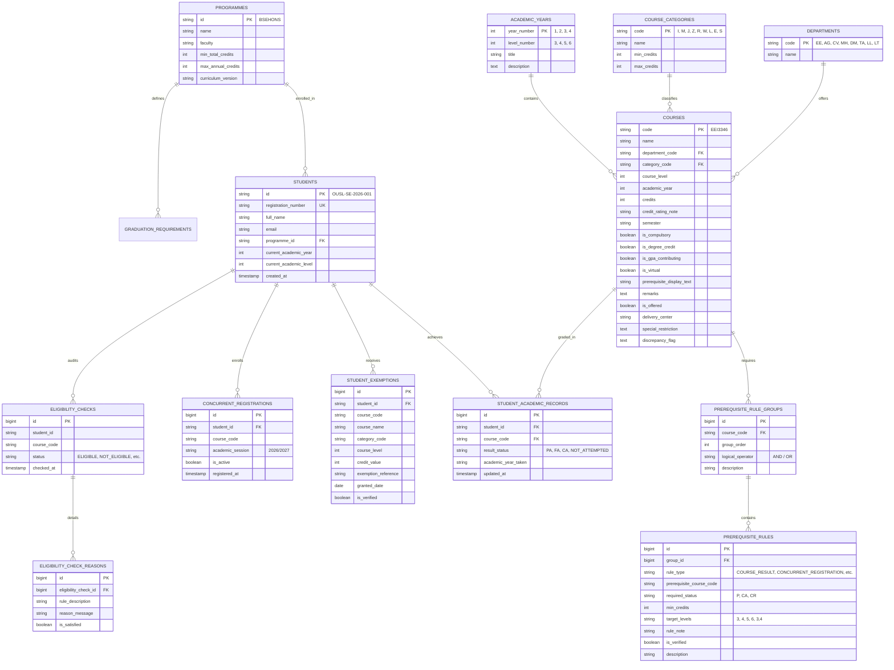

# UniEligible Database Schema Documentation

## 1. Overview
The **UniEligible** database is a normalized PostgreSQL relational schema designed to store the versioned BSEHons curriculum, academic departments, course categories, prerequisite rule trees, student academic records, verified exemptions, and concurrent registrations.

---

## 2. Entity-Relationship (ER) Diagram

---

## 3. Relational Table Specifications

### 3.1 `programmes`
Stores degree programme metadata and global graduation thresholds.
- `id` (VARCHAR(20), PK): Programme identifier (e.g. `BSEHONS`).
- `name` (VARCHAR(200), NOT NULL): Degree programme name.
- `faculty` (VARCHAR(100)): Faculty offering the programme.
- `min_total_credits` (INTEGER, Default: 125): Graduation credit target.
- `max_annual_credits` (INTEGER, Default: 38): Annual registration limit.
- `curriculum_version` (VARCHAR(20)): Syllabus version (`2026/2027`).

### 3.2 `courses`
Holds all course modules across Levels 2 through 6.
- `code` (VARCHAR(20), PK): Unique course code (e.g. `EEI3346`).
- `name` (VARCHAR(200), NOT NULL): Course title.
- `department_code` (VARCHAR(10), FK -> `departments.code`): Department offering the module.
- `category_code` (VARCHAR(5), FK -> `course_categories.code`): Official category code.
- `course_level` (INTEGER, NOT NULL): Academic level (`2`, `3`, `4`, `5`, `6`).
- `academic_year` (INTEGER, NOT NULL): Academic year (`1`, `2`, `3`, `4`).
- `credits` (INTEGER, NOT NULL): Credit value.
- `credit_rating_note` (VARCHAR(20)): Rating notes, such as `2*` for `MHZ2250`.
- `is_degree_credit` (BOOLEAN, NOT NULL): `false` for `MHZ2250` (does not contribute to graduation credits); `true` for standard courses.
- `is_compulsory` (BOOLEAN, NOT NULL): `true` for compulsory; `false` for electives.
- `is_offered` (BOOLEAN, NOT NULL): Offering status for 2026/2027 session (`false` for `EEI5369`, `EEI6279`).
- `delivery_center` (VARCHAR(100)): Venue constraints (`ALL` or `CRC only`).

### 3.3 `prerequisite_rule_groups` & `prerequisite_rules`
Implements modular composite prerequisite evaluation:
- `group_order` (INTEGER): Sequence of evaluation.
- `logical_operator` (VARCHAR(10)): `AND` or `OR` within the rule group.
- `rule_type` (VARCHAR(35)):
  - `COURSE_RESULT` (checks result status against `required_status`)
  - `CONCURRENT_REGISTRATION` (checks co-enrollment in current session)
  - `PASSED_CREDITS_TOTAL` (total passed credits threshold)
  - `PASSED_CREDITS_AT_LEVEL` (level-specific passed credits)
  - `CA_CREDITS_AT_LEVEL` (level-specific continuous assessment credits)
  - `ADMIN_VERIFICATION_REQUIRED` (unverified rule flag)
  - `SPECIAL_RESTRICTION` (advisory restriction check)

### 3.4 `student_academic_records`
Maintains individual student examination and assessment results.
- `student_id` (VARCHAR(50), FK -> `students.id`)
- `course_code` (VARCHAR(20), FK -> `courses.code`)
- `result_status` (VARCHAR(20), NOT NULL): `PA` (Passed), `CA` (Continuous Assessment Pass), `FA` (Failed), `NOT_ATTEMPTED`.
- Constraint: `UNIQUE(student_id, course_code)` guarantees idempotent result updates without duplicate rows.

